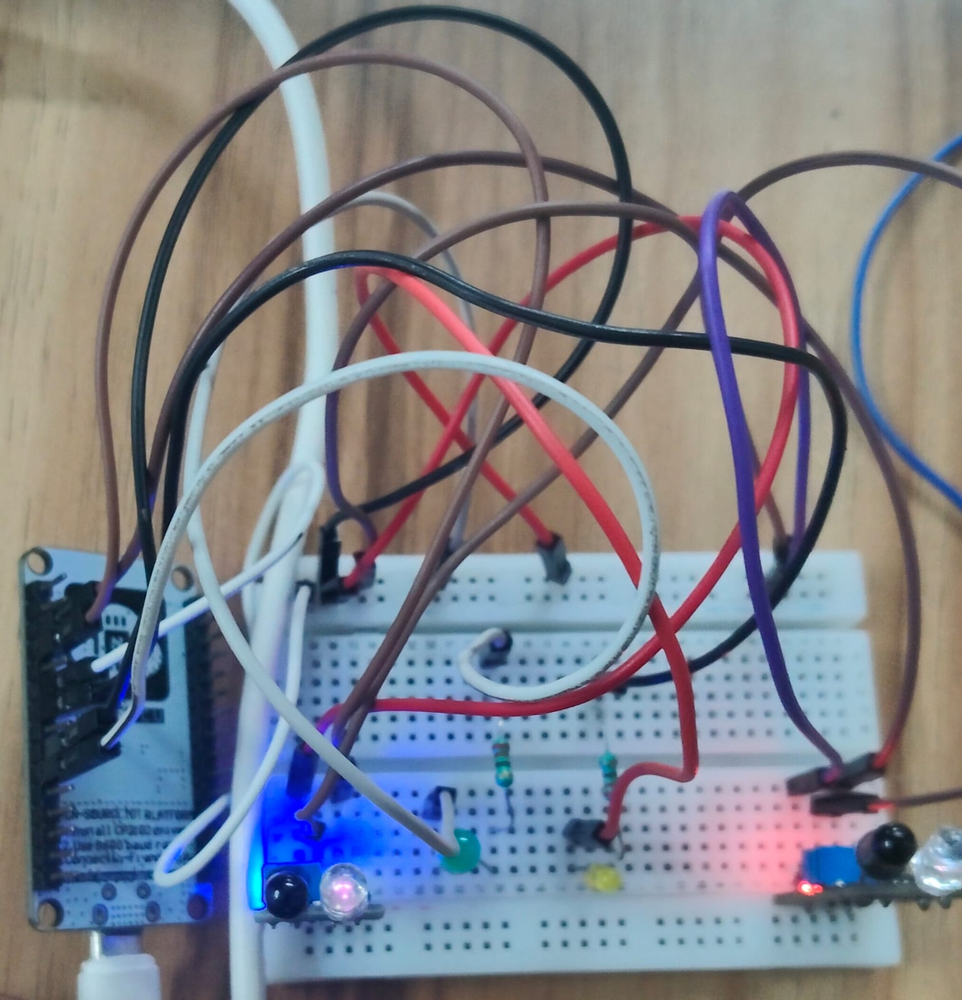
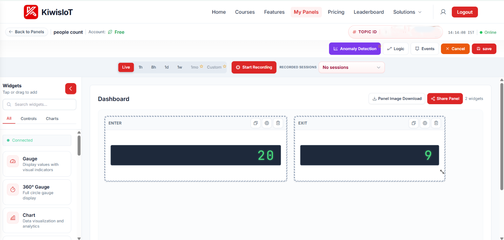

# 👥 Smart People Entry and Exit Monitoring System Using IoT

## 📌 Project Overview

This project is an IoT-based People Entry and Exit Monitoring System developed using the **NodeMCU ESP8266, IR sensors, and LEDs**.

The system uses two IR sensors to detect people entering and leaving an area. When a person enters, the first LED blinks, and when a person exits, the second LED blinks.

The entry and exit detection status is transmitted to the **KiwisIoT platform** through Wi-Fi, allowing remote monitoring through an IoT dashboard.

## 🎯 Objectives

- To detect people entering and exiting an area.
- To implement entry and exit indication using two IR sensors.
- To control two LEDs independently based on sensor detection.
- To establish Wi-Fi communication using NodeMCU ESP8266.
- To monitor entry and exit events through the KiwisIoT platform.

## 🧰 Hardware Requirements

- NodeMCU ESP8266
- 2 IR Sensors
- 2 LEDs
- 2 × 220Ω Resistors
- Breadboard
- Jumper Wires
- USB Cable

## 💻 Software Requirements

- Arduino IDE
- ESP8266 Board Package
- KiwisIoT Library
- KiwisIoT Platform

  [View Arduino Code](./people.ino)

## 🔌 Circuit Connections



| Components | NodeMCU ESP8266 |
|---|---|
| Entry IR Sensor OUT | D1 |
| Exit IR Sensor OUT | D2 |
| LED 1 Positive | D5 |
| LED 2 Positive | D6 |
| Both IR Sensor VCC | 3.3V |
| Both IR Sensor GND | GND |
| Both LED Negative | GND |

*220Ω resistors are connected in series with both LEDs.*

## ⚙️ Working Principle

1. The first IR sensor detects a person entering the area.
2. When entry is detected, LED 1 blinks three times.
3. The second IR sensor detects a person exiting the area.
4. When exit is detected, LED 2 blinks three times.
5. The NodeMCU ESP8266 processes the sensor signals.
6. Entry and exit status values are transmitted to the KiwisIoT platform through Wi-Fi.
7. The detection events can be monitored through the IoT dashboard.

## ☁️ KiwisIoT Platform Integration

KiwisIoT is used to monitor entry and exit detection events remotely.

**Channel Configuration:**

| Channel | Parameter | Value |
|---|---|---|
| Channel 0 | Entry Status | 1 = Detected, 0 = Not Detected |
| Channel 1 | Exit Status | 1 = Detected, 0 = Not Detected |

## 💡 LED Indication

- **Person Entry:** LED 1 blinks three times.
- **Person Exit:** LED 2 blinks three times.
- **No Detection:** Both LEDs remain OFF.

## 📊 Output

**Entry Detection:**
```text
Person Entered
LED 1 ON
Entry Status: 1
Exit Status: 0
```

**Exit Detection:**
```text
Person Exited
LED 2 ON
Entry Status: 0
Exit Status: 1
```



## 📚 Learning Outcomes

Through this project, I learned:

- Interfacing multiple IR sensors with NodeMCU ESP8266.
- Understanding digital input and output.
- Controlling multiple LEDs using Arduino programming.
- Using conditional statements in embedded programming.
- Establishing Wi-Fi connectivity.
- Sending sensor detection data to an IoT platform.
- Monitoring entry and exit events through KiwisIoT.

## 🚀 Future Enhancements

- Implement real-time people counting.
- Display the total number of people inside an area.
- Add an LCD or OLED display.
- Develop a centralized occupancy monitoring dashboard.
- Introduce automated lighting based on occupancy.
